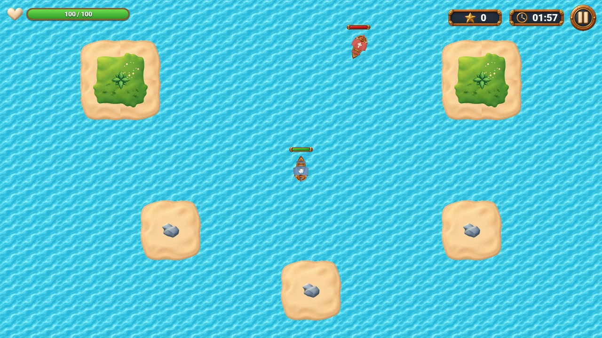

# Pirate Battle

A top-down 2D naval shooter built with **React**, **TypeScript (strict)** and **PixiJS**. Sail between islands, sink enemy ships and score as many points as you can before the clock runs out. Ranking and match history are served by a REST API mocked with **MSW**, consumed with **Axios** and **TanStack Query**. End-to-end and visual tests use **Playwright**.

- **Live demo:** <https://pirate-battle-brown.vercel.app> (Vercel; mocks run in the published build)
- **Architecture and design decisions:** [ARCHITECTURE.md](ARCHITECTURE.md)
- **Test report (HTML):** [docs/test-report/index.html](docs/test-report/index.html)
- **Original challenge statement:** [docs/CHALLENGE.md](docs/CHALLENGE.md)



## Tech stack

| Responsibility | Technology |
| --- | --- |
| Menus, forms, panels, dialogs, HUD | React 19 |
| Language | TypeScript 7, `strict` + `noUncheckedIndexedAccess` + `exactOptionalPropertyTypes` |
| Arena, ships, projectiles, effects, health bars | PixiJS 8 |
| Remote state of ranking and history | TanStack Query 5 |
| HTTP client | Axios |
| API mocks (dev, tests and the published build) | MSW 3 |
| E2E and visual regression | Playwright |
| Build / lint | Vite 8 / oxlint |

## Setup

Requirements: **Node.js 22+** and npm. No private services are needed; the API is mocked in the browser.

```bash
npm ci
npm run dev          # http://localhost:5173
```

Run the Playwright browsers once before the tests:

```bash
npx playwright install chromium
```

## Commands

| Command | What it does |
| --- | --- |
| `npm run dev` | Development server (Vite) on port 5173 |
| `npm run build` | Type-check and optimized production build into `dist/` |
| `npm run preview` | Serves `dist/` on port 4173 |
| `npm run lint` | oxlint |
| `npm run typecheck` | TypeScript project check (app, config and tests) |
| `npm run test:e2e` | Full Playwright suite (builds and previews the optimized bundle first) |
| `npm run test:e2e:ui` | Playwright UI mode |
| `npm run test:e2e:update` | Regenerates the visual baselines |
| `npm run test:e2e:report` | Opens the HTML report from `docs/test-report` |
| `npm run test:e2e:docker` | Runs Playwright inside the official Linux image from a clean copy of the repo (`bash scripts/playwright-docker.sh [args]`) |
| `npm run convert:atlas` | Regenerates the PixiJS JSON atlases from the provided XML ship atlases |
| `npm run profile` | Performance profiling of the optimized build (run `npm run build` first); see [docs/perf](docs/perf/README.md) |
| `npm run lockfile:linux` | Regenerates `package-lock.json` inside Linux so `npm ci` works on every OS (run after changing dependencies on Windows) |

## Environment variables

The game needs **no environment variables**. Everything runs in the browser, including the mocked API. See [.env.example](.env.example).

| Variable | Used by | Purpose |
| --- | --- | --- |
| `BASE_URL` | Playwright | Optional. Runs the suite against an already running URL (e.g. the deployed site) instead of building and previewing locally |
| `CI` | Playwright | Optional. Enables `forbidOnly`, one retry and a fresh preview server |

## Controls

| Action | Keyboard | Touch (landscape) |
| --- | --- | --- |
| Sail forward | `W` / `↑` | ⬆ button (left pad) |
| Turn left / right | `A` / `←`, `D` / `→` | ↶ / ↷ buttons (left pad) |
| Bow cannon (1 shot) | `Space` | center button (right pad) |
| Left / right broadside (3 parallel shots) | `Q` / `E` | side buttons (right pad) |
| Pause / resume | `Esc` or `P`, or the pause button | pause button |

- Moving, turning and firing can be combined (keyboard and multi-touch).
- Game keys are only captured while a match is running; menus keep normal keyboard behaviour.
- Mobile: **landscape** orientation is supported. Touch buttons appear on coarse pointers (phones and tablets). Turning a phone or tablet to portrait pauses the match and asks you to rotate back; **Resume** is offered again in landscape. The rules never change with the screen size.
- Sound: effects and ambience start after the first click (browser autoplay policy). Toggle them with **Sound: on/off** in the main menu or the pause dialog; the choice is saved.
- The game pauses automatically when the window loses focus or the tab is hidden; resuming always requires an explicit action.

## Rules

- Match length: 60–180 s of active play (default 120 s). Enemies spawn every configured interval (default 3 s).
- **Chaser** (red): chases the player and explodes on contact, dealing damage. Its self-destruction does not score.
- **Shooter** (black): approaches the player and fires when in range and with line of sight.
- Every enemy sunk by the player's cannons is worth **1 point**.
- The match ends when time runs out (**Time up**) or the player's ship sinks (**Ship destroyed**). Leaving the battle or reloading abandons the match, and it is not registered.

## Gameplay configuration

All tuning lives in a single typed object: [`src/config/gameConfig.ts`](src/config/gameConfig.ts) (`DEFAULT_CONFIG`). Systems only read it, so balancing never requires changing game logic. Each match uses an **immutable snapshot** taken when it starts; later option changes only affect new matches.

| Group | Parameters (default) |
| --- | --- |
| Session | `durationSec` 120, `spawnIntervalSec` 3, `spawnWeights` chaser 1 / shooter 1, `maxEnemies` 10, `spawnMinDistance` 520 px |
| Arena | 1920 × 1080 logical px (letterboxed to the screen) |
| Player | 100 HP, 170 px/s, 2.6 rad/s, radius 26 |
| Bow cannon | 25 damage, 620 px/s, 560 px range, 0.45 s cooldown |
| Broadside | 3 shots × 20 damage, 540 px/s, 420 px range, 1.2 s cooldown (shared by both sides), 26 px spacing |
| Chaser | 40 HP, 120 px/s, 2.2 rad/s, 20 impact damage |
| Shooter | 60 HP, 95 px/s, 1.8 rad/s, fires inside 480 px, keeps ~320 px, 8 damage, 420 px/s, 520 px range, 1.8 s cooldown, 0.25 rad aim tolerance |
| Damage sprites | damaged ≤ 66 % HP, heavily damaged ≤ 33 % HP |

The **Options** screen exposes the two player options, validated and persisted in `localStorage`:

| Option | Limits | Default |
| --- | --- | --- |
| Game session time | 60–180 s, whole seconds | 120 s |
| Enemy spawn time | 1–10 s, whole seconds (must be positive) | 3 s |

Limits live in `OPTION_LIMITS` in the same file.

## Network scenarios (mocked API)

The ranking and history API is mocked by MSW in **every** environment, including the published build. Its data is stored in `localStorage`, so confirmed matches survive a refresh. Other captains come from deterministic fixtures.

**Selecting a scenario**

- In the app: **Main Menu → "Network scenarios (demo)"**, then pick one from the list. The choice is persisted.
- By URL: `?scenario=<name>`, for example `https://pirate-battle-brown.vercel.app/?scenario=slow`.

**Resetting:** Main Menu → "Network scenarios (demo)" → **Reset mock data**. This restores the fixtures, sets the scenario back to `success`, resets the seeded network randomness and clears the query cache. Matches waiting to be saved on this device are kept.

| Scenario | Behaviour |
| --- | --- |
| `success` | Default. 250 ms latency |
| `instant` | No latency (used by the tests) |
| `empty` | Empty ranking and history |
| `many-pages` | Adds 40 ranking entries and 23 history entries |
| `slow` | 3 s per request |
| `jitter` | 0.1–2.5 s latency from a seeded PRNG (reproducible) |
| `out-of-order` | Odd requests take 2.5 s and even ones 200 ms, so responses arrive out of order |
| `timeout` | Every request exceeds the 4 s client timeout |
| `network-error` | Connection failure |
| `http-400` / `http-500` / `http-503` | That status on every route |
| `ranking-fails` / `history-fails` | Only that route returns 500 |
| `post-timeout-after-commit` | Saving stores the match but answers after the timeout; the retry gets the stored record |
| `offline-at-end` | Saving fails with a connection error; reads still work |

## Reproducing failures

> In the failure scenarios the browser's DevTools console shows its own network log lines such as `Failed to load resource: the server responded with a status of 500` or `net::ERR_FAILED`. They come from the browser reporting the simulated HTTP failure; the application handles them and throws no errors.

| Situation | How to reproduce | Expected behaviour |
| --- | --- | --- |
| Ranking or history unavailable | `?scenario=ranking-fails` (or `history-fails`), open the Captain's Log | Accessible error with **Try again**; the game, options and other tab keep working |
| Slow or out-of-order responses | `?scenario=slow` / `?scenario=out-of-order`, then page quickly | Loading and "Updating…" states; the most recent page is never replaced by a late response |
| Save fails at the end of a match | `?scenario=offline-at-end`, then finish a match | Result shows "Battle not saved yet" with **Retry save**; the menu lists the pending battle; you can start another match |
| Pending save survives a refresh | Same as above, reload the result page, then select `success` in the scenario panel | The result is restored after the reload; the pending match is sent automatically when the scenario changes, on `online`, on app start or on **Retry** |
| Timeout after the server stored the match | `?scenario=post-timeout-after-commit`, finish a match | "Saving battle…" then "Battle saved"; exactly one entry in history and ranking |
| Asset loading failure | `?test&failAssetsOnce`, then press Play | "Loading failed" with **Retry**; retry starts the match |

## Testing

The suite covers the 12 areas required by the challenge plus visual regression. It runs in Chromium **desktop** (1280×720) and **mobile** (Pixel 7, landscape, touch) against the optimized build.

```bash
npm run test:e2e                         # 72 tests (touch and portrait tests are skipped on desktop)
npm run test:e2e:report                  # open docs/test-report
npm run test:e2e:docker -- 13-visual     # visual tests on Linux, inside Docker
```

- **Reproducible:** each test uses a fixed seed (`?seed=`) and a manual clock (`?manualClock`). Time only advances through `advance(seconds)`, which runs the real fixed-step simulation: rules, inputs, collisions and rendering.
- **Isolated:** a new browser context per test (fresh `localStorage`, service worker and cache).
- **Real controls:** tests press keys and touch buttons, then observe the game through a read-only test hook.
- **Clean console:** every test fails on unexpected console errors or page exceptions. The only exception is the browser's own "Failed to load resource" log for failures that are simulated on purpose.
- **Artifacts:** HTML report in `docs/test-report/`; traces and screenshots of failed tests in `test-results/`.
- **Visual baselines:** `tests/e2e/__screenshots__/` (menu, arena, result × desktop/mobile), generated on **Linux** with `npm run test:e2e:docker -- 13-visual --update-snapshots`. There is no OS suffix. The comparison uses `threshold: 0.3` and `maxDiffPixelRatio: 0.03`; the measured worst case on Windows against the Linux baselines is **1.79 %**. Run `PW_MAX_DIFF_RATIO=0 npm run test:e2e -- 13-visual` to print the real difference of each capture. Details in [ARCHITECTURE.md § Testing](ARCHITECTURE.md#testing).
- **Against the published site:** `BASE_URL=https://pirate-battle-brown.vercel.app npm run test:e2e` runs the same suite against the deployment (70 passed, 2 skipped; one result-screen test timed out once under parallel network load and passed on rerun).
- **Clean checkout on Linux:** `npm run test:e2e:docker` copies the repository (without `node_modules`) into the official Playwright image, runs `npm ci` and the whole suite. The report in `docs/test-report/` comes from that run.

### Test-only URL parameters

They only work together with `?test`.

| Parameter | Effect |
| --- | --- |
| `test` | Exposes the running match as `window.__PIRATE_TEST__` (`sim`, `store`, `advance`, `pause`, `resume`) |
| `seed=<n>` | Fixed seed for spawns (also works without `test`) |
| `manualClock` | The ticker only renders; game time advances only through `advance()` |
| `overrides=<json>` | Partial `GameConfig` for the match, e.g. `{"session":{"maxEnemies":0}}` |
| `failAssetsOnce` | The first asset load requests a missing file |
| `sound` | Enables audio in test mode (audio is off with `?test` so the suite stays fast and silent) |
| `perf` | Records frame times and per-second entity counts into `window.__PIRATE_PERF__` (also works without `test`) |

## Performance

Full report: [docs/perf/README.md](docs/perf/README.md). Reference environment: Intel Core i5-10210U notebook, Intel UHD integrated GPU, 8 GB RAM, Windows 11, Chromium 159 headed, 1920×1080 canvas, optimized build.

| 180 s match | Avg FPS | p95 frame time | Max enemies / display objects |
| --- | ---: | ---: | ---: |
| Standard (default config, autopilot) | 56.8 | 17.1 ms | 2 / 94 |
| Stress (spawn every 1 s, up to 40 enemies) | 59.7 | 17.0 ms | 40 / 350 |

After 5 start → play → leave cycles, DOM nodes, listeners and canvases stay flat and no game object survives a match (verified by heap census). The JS heap grows by a few hundred KB, which comes from V8 compiled code and per-renderer PixiJS caches; the details are in the report.

```bash
npm run build && npm run profile    # ~10 min, opens a Chromium window; writes docs/perf/results.*
```

## Project structure

```
src/
  app/          App shell, screen state machine, last result persistence
  config/       Typed gameplay config and player options (validation, persistence)
  game/
    sim/        Pure game rules: Simulation, collisions, flow-field navigation, PRNG, arena map
    render/     PixiJS renderer (layers, sprites, effects, health bars, pooling)
    input/      Keyboard + touch input controller
    assets/     Texture loading with progress, validation and retry
    GameSession.ts  Owns a match: Pixi app, fixed-step loop, pause, lifecycle
    store.ts    Minimal external store for React (useSyncExternalStore)
  api/          Contracts, Axios client, TanStack Query hooks, pending-save outbox, player identity
  mocks/        MSW handlers, localStorage "database", fixtures, network scenarios
  ui/           React screens and components
tests/e2e/      Playwright specs, helpers and visual baselines
scripts/        Atlas conversion, Docker test runner
public/assets/  Game assets (provided by the challenge)
docs/           Challenge statement, test report, performance report
```

## Assets and licenses

All game art and sounds come from the challenge repository ([junglegaming/game-developer-challenge](https://github.com/junglegaming/game-developer-challenge)) and are used unchanged. The only derived files are the JSON versions of the ship atlases, generated by `scripts/convert-atlas.mjs`. The UI font is **Roboto** (SIL Open Font License 1.1), bundled through the `@fontsource/roboto` package so text looks the same on every OS. See [public/assets/LICENSE.md](public/assets/LICENSE.md).

## Known limitations

- The whole arena is scaled to fit the screen, so ships are small on phones.
- The player's captain name is generated on the first visit and cannot be edited.
- The pause dialog has no Options shortcut: opening Options would abandon the running match.
- In headless Chromium (software WebGL) the frame rate is low, and the per-frame step clamp slows the game in real time. Tests use the manual clock for that reason.
