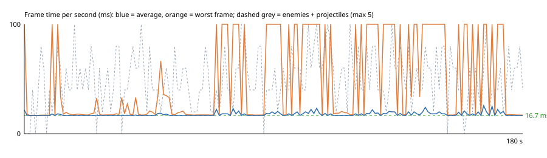
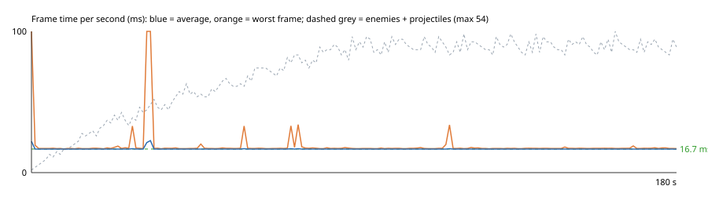

# Performance report

Target: **60 FPS** on the reference environment below, measured on the **optimized build** (`npm run build` + `vite preview`).

- Raw numbers: [results.json](results.json) · generated summary: [results.md](results.md)
- Per-second entity samples: [samples-standard.json](samples-standard.json), [samples-stress.json](samples-stress.json)
- Reproduce: `npm run build && npm run profile` (`scripts/profile.mjs`, about 10 minutes; a Chromium window opens)

## Reference environment

| Item | Value |
| --- | --- |
| Machine | Notebook, Intel Core i5-10210U @ 1.60 GHz (4 cores / 8 threads, up to 4.2 GHz turbo) |
| GPU | Intel UHD Graphics (integrated), driver 31.0.101.2141, via ANGLE / Direct3D 11 |
| Memory | 8 GB |
| OS | Windows 11 Pro 10.0.26300 |
| Display | 1366×768 @ 60 Hz (physical panel) |
| Browser | Chromium 159.0.8154.6 (Playwright build), **headed** (real GPU), background throttling disabled |
| Viewport / canvas | 1920×1080 CSS px, devicePixelRatio 1 → 1920×1080 canvas (larger than the panel; a conservative choice) |
| Build | `vite build` production bundle served by `vite preview` |

## Method

`scripts/profile.mjs` drives the real game in a headed Chromium:

1. **Frame times.** With `?perf`, `GameSession` records the PixiJS ticker's `deltaMS` for every frame of a *running* match (paused and ended frames are excluded). Once per second it also samples enemies, projectiles, effects and the total number of PixiJS display objects on stage.
2. **Standard match (180 s).** Default configuration (spawn every 3 s, up to 10 enemies, seed 42). An aim-and-fire autopilot plays through the real keyboard listeners. The player's health is raised to 1,000,000 (`?test&overrides`) only so the match always lasts the full 3 minutes.
3. **Stress match (180 s).** Spawn every 1 s, up to 40 enemies, idle invulnerable player. Enemies accumulate and shooters keep firing: the worst case the rules allow with a high enemy cap.
4. **Memory.** In a fresh page: measure in the menu, then 1 warm-up cycle plus 5 cycles of *Play → 30 s of autopilot play → Pause → Main Menu*. After each cycle the script forces garbage collection 3 times through the Chrome DevTools Protocol (`HeapProfiler.collectGarbage`) and records the JS heap (`Runtime.getHeapUsage`), DOM nodes and JS event listeners (`Memory.getDOMCounters`), the number of canvases, and whether a game session is still referenced.

FPS = frames / recorded seconds. p95 = 95th percentile of the frame times. The PixiJS ticker caps a single `deltaMS` at 100 ms (`minFPS` 10), so 100 ms is the largest value that can be recorded for one frame.

## Results (final run, 2026-11-23)

### Frame rate, 180 s matches

| Metric | Standard match | Stress match |
| --- | ---: | ---: |
| Enemies on screen (avg / max) | 0.8 / 2 | 31.9 / 40 |
| Projectiles (avg / max) | 1.7 / 4 | 6.6 / 14 |
| Effects (avg / max) | 1.7 / 6 | 10.8 / 22 |
| PixiJS display objects (avg / max) | 86 / 94 | 287 / 350 |
| Frames recorded | 10,224 | 10,752 |
| **Average FPS** | **56.8** | **59.7** |
| Median frame time | 16.7 ms | 16.7 ms |
| **p95 frame time** | **17.1 ms** | **17.0 ms** |
| p99 frame time | 100 ms | 17.2 ms |
| Frames > 33 ms | 132 (1.3 %) | 12 (0.1 %) |
| Score (autopilot) | 59 | 0 (idle) |
| Console warnings / errors | none | none |

Charts (per-second average and worst frame, with the entity count dashed): [standard](frame-times-standard.svg) · [stress](frame-times-stress.svg)

### All runs (hitch analysis)

Long frames (> 33 ms) were recorded with timestamps in every run:

| Run | Standard: FPS · p95 · frames > 33 ms | Stress: FPS · p95 · frames > 33 ms |
| --- | --- | --- |
| 1st full run (WMI queries running in parallel on the machine) | 58.6 · 17.3 ms · 61 | 56.6 · 17.2 ms · 147 |
| Stress only, idle machine, 90 s ([investigation-stress.json](investigation-stress.json)) | – | 59.8 · 16.9 ms · 3 |
| Final run (user activity in other apps during the standard match) | 56.8 · 17.1 ms · 132 | 59.7 · 17.0 ms · 12 |

- **Long frames do not follow game load.** The stress match handles 4× more display objects and 40 enemies, yet it had the *fewest* hitches in two of three runs. The same scenario swings from 12 to 147 hitches between runs.
- In the final standard match the hitches came in bursts between 40 s and 180 s (2–17 per 10 s window), while other applications were in use. In the idle 90 s stress run there were only 3: two during start-up (shader compilation, texture upload) and one isolated.
- Median (16.7 ms) and p95 (16.9–17.3 ms) are stable in every run, at the 60 Hz vsync interval.
- Conclusion: the game **meets the 60 FPS target** on this integrated-GPU notebook. The remaining hitches come from the shared desktop environment (other processes, window activity), not from the simulation or the renderer.

### Memory: 5 cycles of start → play 30 s → leave (forced GC before each measurement)

| Measurement | JS heap | DOM nodes | JS listeners | Canvases | Game session referenced |
| --- | ---: | ---: | ---: | ---: | --- |
| Menu, before any match | 4.58 MB | 216 | 176 | 0 | no |
| After warm-up cycle | 7.36 MB | 219 | 193 | 0 | no |
| After cycle 1 | 7.62 MB | 219 | 193 | 0 | no |
| After cycle 2 | 7.82 MB | 219 | 193 | 0 | no |
| After cycle 3 | 7.94 MB | 219 | 193 | 0 | no |
| After cycle 4 | 8.08 MB | 219 | 193 | 0 | no |
| After cycle 5 | 8.16 MB | 219 | 193 | 0 | no |

- The first match adds ~2.8 MB, mostly the texture atlases kept in the `Assets` cache for later matches. It also adds 3 DOM nodes and 17 listeners, a one-off from first-use initialisation that was not attributed further. These numbers then stay flat for every later cycle.
- DOM nodes, listeners and canvases are **identical after every cycle**, and no session is left referenced.
- The JS heap still grows slightly, with smaller increments each cycle (+0.26, +0.20, +0.12, +0.14, +0.08 MB). This was investigated as follows.

### Investigation of the heap growth

1. **More cycles** ([investigation-memory.json](investigation-memory.json), 15 cycles of 10 s): increments keep shrinking to about **+0.05 MB per match** (8.90 MB after 15 cycles).
2. **Heap snapshot diff** between cycle 4 and cycle 12 (CDP `HeapProfiler.takeHeapSnapshot`): of the ~0.7 MB growth, **~0.49 MB is V8 compiled code** (`InstructionStream`, `Code`, `FeedbackVector`, …). This is the JIT optimising more functions as they get hot, and it levels off. Another ~43 KB is shader source strings, one set per new WebGL renderer.
3. **Object census on an unminified build** ([`scripts/heap-objects.mjs`](../../scripts/heap-objects.mjs)):

| Class | During a match | After 4 cycles | After 12 cycles |
| --- | ---: | ---: | ---: |
| GameSession / Simulation / GameRenderer / InputController / FlowField | 1 each | **0** | **0** |
| PixiJS Application / WebGLRenderer / RenderGroup | 1 each | **0** | **0** |
| Sprite | 72 | **0** | **0** |
| Container | 13 | 2 | 2 |
| Texture (shared atlas cache) | 175 | 172 | 172 |

**No game object survives leaving a match.** The only per-match growth that remains is inside PixiJS: one `BindGroup` and one event emitter per destroyed renderer, plus that renderer's shader source strings. They stay referenced from the shared texture sources and PixiJS's global program cache, because every match creates a new WebGL renderer while reusing the cached textures. That is a few KB per match, about 1 MB per 100 matches. It could be removed by keeping one PixiJS `Application` alive for the whole app instead of one per match. This is noted as a possible improvement rather than changed this close to delivery.

## Limitations of these measurements

- Integrated GPU notebook with a 60 Hz panel: FPS cannot exceed 60 (vsync), and the machine was shared with other applications, which explains the run-to-run variance in hitches.
- The canvas is 1920×1080 while the physical panel is 1366×768. The window is larger than the screen, so part of it is off-screen; rendering cost is still that of a 1080p canvas.
- Playwright's Chromium build, headed, with background throttling disabled. Stable Chrome, Firefox and Safari were not profiled.
- Mobile devices were not profiled on real hardware.
- The player is invulnerable (`maxHealth` override) so both matches last the full 180 s. The standard autopilot kills quickly, so standard-match entity counts are lower than a human would face. The stress match covers the high end.
- The PixiJS ticker caps a single frame at 100 ms, so longer stalls are recorded as 100 ms.
- Memory figures are JS heap only (`Runtime.getHeapUsage`). GPU memory is not measured, but the census shows no renderer or WebGL objects surviving a match.
