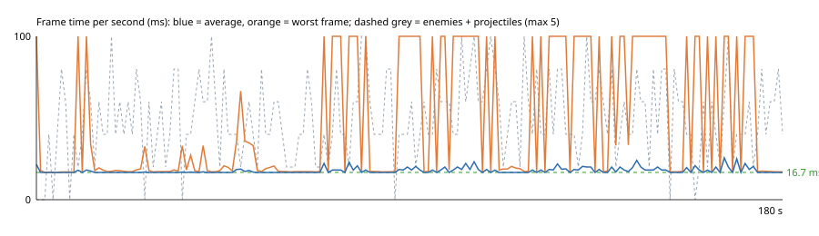
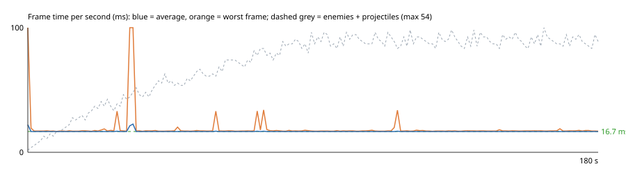

# Profiling results (2026-11-23T20:17:22.084Z)

## Environment

- **os**: Windows_NT 10.0.26300 (x64)
- **cpu**: Intel(R) Core(TM) i5-10210U CPU @ 1.60GHz × 8 threads
- **memoryGb**: 7.9
- **browser**: Chromium 159.0.8154.6 (Playwright, headed)
- **gpu**: ANGLE (Intel, Intel(R) UHD Graphics (0x00009B41) Direct3D11 vs_5_0 ps_5_0, D3D11)
- **viewport**: 1920×1080 CSS px
- **devicePixelRatio**: 1
- **screen**: 1920×1080

## Standard match (180 s)

Config: spawn every 3 s · overrides {"player":{"maxHealth":1000000}} · autopilot on · score 59 · auto-resumes 0

| Metric | Whole match | After 2 s warm-up |
| --- | ---: | ---: |
| frames | 10224 | 10104 |
| seconds | 180 | 177.8 |
| avgFps | 56.8 | 56.8 |
| avgMs | 17.61 | 17.6 |
| p50Ms | 16.7 | 16.7 |
| p95Ms | 17.1 | 17.1 |
| p99Ms | 100 | 100 |
| maxMs | 100 | 100 |
| over20Ms | 163 | 160 |
| over33Ms | 132 | 129 |

| Entities (per-second samples) | Average | Max |
| --- | ---: | ---: |
| enemies | 0.8 | 2 |
| projectiles | 1.7 | 4 |
| effects | 1.7 | 6 |
| displayObjects | 86.1 | 94 |

Console warnings/errors: none

## Stress match (180 s)

Config: spawn every 1 s · overrides {"player":{"maxHealth":1000000},"session":{"maxEnemies":40}} · autopilot off · score 0 · auto-resumes 0

| Metric | Whole match | After 2 s warm-up |
| --- | ---: | ---: |
| frames | 10752 | 10632 |
| seconds | 180 | 177.8 |
| avgFps | 59.7 | 59.8 |
| avgMs | 16.74 | 16.72 |
| p50Ms | 16.7 | 16.7 |
| p95Ms | 17 | 17 |
| p99Ms | 17.2 | 17.2 |
| maxMs | 100 | 100 |
| over20Ms | 18 | 15 |
| over33Ms | 12 | 9 |

| Entities (per-second samples) | Average | Max |
| --- | ---: | ---: |
| enemies | 31.9 | 40 |
| projectiles | 6.6 | 14 |
| effects | 10.8 | 22 |
| displayObjects | 286.7 | 350 |

Console warnings/errors: none

## Memory: 5 cycles of start → play 30 s → leave (after forced GC)

| Measurement | JS heap (MB) | DOM nodes | JS listeners | Canvases | Session alive | Played (s) |
| --- | ---: | ---: | ---: | ---: | --- | ---: |
| menu, before any match | 4.58 | 216 | 176 | 0 | none | – |
| after warm-up cycle | 7.36 | 219 | 193 | 0 | none | 29.8 |
| after cycle 1 | 7.62 | 219 | 193 | 0 | none | 30.2 |
| after cycle 2 | 7.82 | 219 | 193 | 0 | none | 30.3 |
| after cycle 3 | 7.94 | 219 | 193 | 0 | none | 30.1 |
| after cycle 4 | 8.08 | 219 | 193 | 0 | none | 28 |
| after cycle 5 | 8.16 | 219 | 193 | 0 | none | 29.3 |

Console warnings/errors: none
